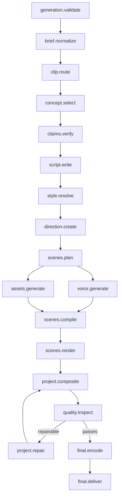

# ShortClipr final-output generation pipeline

Overall implementation authority: [System blueprint](SHORTCLIPR_SYSTEM_BLUEPRINT.md), including exact retained services, durable orchestration and rendering. This document supplies detailed product contracts; the system blueprint supersedes older infrastructure proposals.

Model routing authority: [Scene capability routing](SHORTCLIPR_SCENE_ROUTING.md). Assign models per scene operation using qualified capability and expected completion cost; bypass Luna when it is ineligible, and do not presume Terra can solve every unsupported task.

Status: authoritative product and engineering blueprint  
Date: 2 November 2026  

ShortClipr accepts one topic or creative brief, lets the user select an UnrealSpeech language and voice, lets the user choose a visual style or delegate style selection to AI, and returns a finished animated short.

The production AI-model layer is defined in [`SHORTCLIPR_LUNA_TERRA_ANIMATION_SYSTEM.md`](SHORTCLIPR_LUNA_TERRA_ANIMATION_SYSTEM.md): GPT-6 Luna plans and programs scenes, GPT-6.1 Terra performs selective visual direction and repair, and deterministic workers render the result.

There are no user-facing concept boards, scripts, storyboards, animatics, scene previews, voice auditions, design approvals, timelines, or intermediate videos. All creative planning, rendering checks, and repairs happen internally. The first creative result shown to the user is the final encoded video.

---

## 1. Fixed product decisions

1. User provides a topic, prompt, script, or brief.
2. User selects a supported language.
3. User selects one UnrealSpeech voice available for that language.
4. User selects a visual style or chooses **AI Auto Style**.
5. User selects duration and aspect ratio.
6. User submits once.
7. ShortClipr performs the entire production pipeline internally.
8. The user sees generation status without creative intermediates.
9. The first playable media shown is the final video.
10. After completion, the user can download it or request a new final variation.
11. The normal production path uses GPT-6 Luna and GPT-6.1 Terra only; stronger models are not silently substituted.

### Explicitly excluded from the creator flow

- Concept selection.
- Script approval.
- Storyboard approval.
- Character sheet approval.
- Voice audition playback.
- Animatic playback.
- Scene-by-scene preview.
- Partial render preview.
- Timeline editing before completion.
- Live visibility into generated prompts or code.

Internal artifacts still exist because the system needs structured planning, determinism, validation, and targeted repairs. They are system records, not creator screens.

---

## 2. UnrealSpeech capability boundary

As of 2 November 2026, UnrealSpeech advertises 48 voices across eight language groups rather than every world language:

- English (United States).
- English (United Kingdom).
- Mandarin Chinese.
- Hindi.
- Spanish.
- Portuguese.
- Japanese.
- French.
- Italian.

English has two locale groups, so the product UI may display nine locale choices while describing the provider as supporting eight languages.

ShortClipr must show every voice returned by the supported UnrealSpeech catalogue, but it must not label unavailable languages as supported. The catalogue is provider-managed and should be synchronized instead of permanently hard-coded into the frontend.

Official provider references:

- [UnrealSpeech product and language information](https://unrealspeech.com/)
- [UnrealSpeech `/speech` API](https://docs.unrealspeech.com/reference/speech)
- [UnrealSpeech streaming API](https://docs.unrealspeech.com/reference/stream)

### Endpoint choice for ShortClipr

For clips up to 60 seconds, use the synchronous `/speech` family when word or sentence timestamps are required. UnrealSpeech documents approximately 850 characters per minute and a 3,000-character limit for this endpoint. Store the provider base URL in configuration because public examples currently reference different API versions.

Do not use `/stream` for production narration when it cannot supply the required timestamp contract. Do not use `/synthesisTasks` for ordinary sub-minute clips unless provider behavior or batching requirements justify it.

### Provider adapter configuration

Introduce only when implementation begins:

- `UNREALSPEECH_API_KEY`
- `UNREALSPEECH_API_BASE`
- `UNREALSPEECH_MODEL`
- `UNREALSPEECH_DEFAULT_BITRATE`
- `UNREALSPEECH_CATALOG_TTL_SECONDS`

These are new feature variables. They do not rename any retained variables from `PLATFORM_HANDOFF.md`.

### Voice catalogue record

```json
{
  "provider": "unrealspeech",
  "voice_id": "hf_alpha",
  "display_name": "Ananya",
  "language": "hi",
  "locale": "hi-IN",
  "gender_label": "female",
  "description": "Young Hindi female voice",
  "model": "kokoro",
  "enabled": true,
  "catalog_revision": "2026-11-02"
}
```

Do not infer language from the voice ID inside rendering code. Resolve it through the synchronized catalogue.

### Voice selection rules

- Language selection filters the voice list immediately.
- Voice selection is required for narrated videos.
- Changing language clears an incompatible voice.
- The selected voice ID and catalogue revision are stored with the project.
- Speed and pitch remain at tested defaults in the first release.
- Advanced speed or pitch controls can be introduced later with duration validation.
- If UnrealSpeech removes a voice before generation, fail before reserving render compute and ask the user to choose another voice.
- If a provider request fails transiently, retry internally.
- If voice generation cannot complete, do not create a silent final video unless the user explicitly selected a no-narration mode.

---

## 3. User experience

The product has four primary screens.

### Screen A: Dashboard

- New video button.
- Previous completed videos.
- Jobs currently generating.
- Failed jobs with safe, actionable messages.
- Plan and remaining generation entitlement.

No unfinished creative artifact is playable from the dashboard.

### Screen B: Create video

#### Main brief field

Label: **What should ShortClipr create?**

Accept:

- A topic.
- A detailed brief.
- A complete script.
- Factual notes.
- A story premise.
- A product/ad brief.

Limit the first release to text plus explicitly supported asset uploads. URLs and sources can be accepted only when the research adapter can retrieve and verify them safely.

#### Required controls

1. **Language**
   - Shows only supported UnrealSpeech languages/locales.

2. **Voice**
   - Filtered by language.
   - Displays voice name, locale, gender label, and provider description.
   - No audition player.

3. **Visual style**
   - AI Auto Style.
   - Clean Vector.
   - Editorial Data.
   - Paper Cutout.
   - Technical Blueprint.
   - Comic Panels.
   - Pixel World.
   - Isometric World.
   - Atmospheric Silhouette.
   - Limited 3D.
   - Show only style/type combinations that have passed validation.

4. **Duration**
   - 15 seconds.
   - 30 seconds.
   - 45 seconds.
   - 60 seconds.

5. **Aspect ratio**
   - 9:16.
   - 16:9.
   - 1:1.

#### Optional controls

- Clip type: AI Auto or one of the approved types.
- Tone: educational, cinematic, playful, suspenseful, energetic, calm, professional.
- Captions: on or off.
- Brand kit.
- Call to action for advertisements.
- Uploaded references or product assets.

#### Primary action

**Generate final video**

Before submission show:

- Estimated usage units.
- Selected duration and ratio.
- Selected language and voice.
- Chosen style or AI Auto Style.
- A clear statement that the next creative result will be the finished video.

### Screen C: Generation status

The user sees status, not creative media.

Allowed progress labels:

1. Understanding your brief.
2. Writing the short.
3. Designing the visual direction.
4. Building scenes.
5. Generating narration.
6. Animating.
7. Finishing sound and captions.
8. Checking the final video.

Do not expose:

- Script text.
- Storyboards.
- Generated frames.
- Scene thumbnails.
- Voice audio.
- Partial video.
- Renderer choice.
- Model prompts.
- Internal quality scores.

The page provides:

- Overall status.
- Approximate stage, without fabricated time promises.
- Cancel button when cancellation remains safe.
- Background generation support.
- Notification when complete.

### Screen D: Final result

This is the first screen that displays generated creative media.

- Final video player.
- Download button.
- Title and technical metadata.
- Selected voice, language, style, duration, and ratio.
- Generate another final version.
- Duplicate settings into a new creation.
- Delete project.

Future optional post-result edits can create a new final version, but they do not reveal intermediate scenes.

---

## 4. Final-only pipeline

```mermaid
flowchart LR
    A[Topic or brief] --> B[Language and UnrealSpeech voice]
    B --> C[Style choice or AI Auto]
    C --> D[Duration and ratio]
    D --> E[Submit once]
    E --> F[Internal creative planning]
    F --> G[Internal script and verification]
    G --> H[Internal art direction and scene plan]
    H --> I[Assets, narration, and timing]
    I --> J[Scene compilation and rendering]
    J --> K[Composition, sound, captions]
    K --> L[Internal quality check and auto-repair]
    L --> M[Final encoded video]
    M --> N[First user-visible creative output]
```



### Internal stages

#### 1. Intake validation

- Validate ownership and entitlement.
- Validate prompt length and asset count.
- Validate language/voice compatibility.
- Validate style/type compatibility.
- Validate duration/ratio availability.
- Create the immutable generation request.
- Estimate and reserve usage.

#### 2. Brief normalization

Convert input into:

- Subject.
- Audience.
- Intended takeaway or emotion.
- Clip family.
- Tone.
- Runtime.
- Language.
- Voice.
- Style mode.
- Aspect ratio.
- Factuality requirements.
- Required assets.
- Restrictions.

If the input is sparse but usable, make conservative creative assumptions and continue automatically. Reject only an unusable request before spending provider or render credits; do not introduce an approval or preview step.

#### 3. Clip-type routing

AI Auto selects one of the approved clip types based on the brief. A user-selected clip type is respected unless it is incompatible with the request or current production capability.

#### 4. Concept selection

The AI generates several internal candidates and selects one using:

- Clarity.
- Originality.
- Topic fit.
- Audience fit.
- Style compatibility.
- Available assets/actions.
- Production feasibility.
- Cost and runtime.
- Main failure risk.

Candidates are never shown to the user.

#### 5. Research and claim validation

For factual clips:

- Extract claims.
- Attach source and as-of date.
- Calculate charts and simulations in code.
- Block unsupported factual claims.
- Distinguish fact, inference, user-provided assertion, and illustrative fiction.

For fiction:

- Establish world rules.
- Establish character/object continuity.
- Validate that the ending follows from earlier events.

#### 6. Script generation

- Generate narration/dialogue in the selected language.
- Fit the target duration without unnaturally fast speech.
- Preserve demonstration time.
- Create opening, progression, and payoff.
- Validate pronunciation-sensitive terms.
- Reject unsupported text before voice generation.

#### 7. Style resolution

##### Manual style

Load the exact approved style-pack revision selected by the user.

##### AI Auto Style

Select using:

- Subject and clip type.
- Tone.
- Information density.
- Need for characters, maps, charts, simulation, or environment.
- Aspect ratio.
- Current renderer capability.
- Available assets.
- Production level and entitlement.

The AI must choose from validated style packs. It cannot invent an unsupported renderer/style combination at runtime.

#### 8. Internal art direction

Produce:

- Palette.
- Typography.
- Shape/stroke system.
- Texture.
- Lighting.
- Camera rules.
- Motion rules.
- Caption rules.
- Sound vocabulary.
- Character/prop/environment requirements.

#### 9. Internal scene planning

Create versioned scene contracts containing:

- Purpose.
- Entry and exit state.
- Focal action.
- Assets.
- Timing.
- Camera.
- Narration/dialogue.
- Sound events.
- Captions.
- Claims.
- Rejection conditions.
- Renderer route.

#### 10. UnrealSpeech narration

- Send the finalized script using the selected voice ID.
- Request word timestamps where the chosen endpoint/model supports them.
- Persist provider task ID, selected voice, API version, catalogue revision, audio, and timestamps.
- Copy provider output into ShortClipr-controlled GCS before provider URLs expire.
- Validate audio duration, decode, channel layout, and silence.
- Fit animation timing to actual voice duration.

#### 11. Asset production

Generate or retrieve:

- Typography and vector components.
- Illustrations.
- Maps and diagrams.
- Props and environments.
- Character rigs when required.
- Sound effects and music under the selected policy.

Assets are internally validated before rendering. No asset sheet is shown to the creator.

#### 12. Scene compilation

Route each scene independently:

| Lane | Typical content | Candidate renderer |
|---|---|---|
| P1 | Typography, charts, diagrams | Revideo + SVG/Canvas |
| P2 | Layered 2D, maps, environments | Revideo/Canvas/Three.js |
| P3 | Simulation and transformation | Deterministic JS + Canvas/Three.js |
| P4 | Rigged characters and dialogue | Revideo/Canvas or validated Three.js rigs |

The capability router assigns Luna or Terra before each scene-code operation using tested task-family eligibility. Rendering and visual-review routes are separate. Unsupported scenes require a qualified decomposition or fail explicitly. The normal generation path does not create unrestricted renderer or Blender programs per request.

#### 13. Scene rendering

- Render scenes from immutable contracts.
- Pin renderer build, style revision, assets, fonts, seed, ratio, resolution, and frame rate.
- Cache by full dependency hash.
- Do not expose scene output to the user.

#### 14. Composition

- Assemble scenes.
- Mix narration, music, ambience, and effects.
- Apply captions.
- Apply final color and transitions.
- Produce an internal review encode.

#### 15. Internal quality inspection

Mechanical checks run locally. Terra receives only scenes that cross the visual-risk threshold defined in the Luna–Terra system design.

Check:

- Duration, dimensions, frame rate, codec.
- Missing frames/assets.
- Text readability.
- Safe areas.
- Continuity.
- Cause/effect order.
- Contact timing.
- Narration synchronization.
- Audio intelligibility.
- Caption timing.
- Factual consistency.
- Complete ending.

#### 16. Automatic repair

- Create timestamped defects.
- Route schema, compile, timing, and contract defects to local fixes or a model qualified for that repair; stop Luna immediately on capability mismatch.
- Route composition, hierarchy, crop, contrast, collision, and focal-point defects to Terra with a minimal visual-review packet.
- Invalidate the smallest affected dependency set.
- Re-render only affected scenes/layers.
- Recheck the repaired interval and adjacent cuts.
- Enforce a strict attempt and cost limit.
- If the final cannot pass critical gates, fail safely and release/refund eligible usage.

#### 17. Delivery encoding

- Encode the requested final ratio and resolution.
- Inspect the encoded file from beginning to final frame.
- Create checksum and metadata.
- Store in GCS.
- Mark the project complete.
- Only now expose the video to the user.

---

## 5. State model

### User-visible states

```text
DRAFT
QUEUED
GENERATING
FINALIZING
COMPLETE
FAILED
CANCELLED
```

### Internal states

```text
VALIDATING
NORMALIZING_BRIEF
ROUTING_CLIP_TYPE
SELECTING_CONCEPT
VERIFYING_CLAIMS
WRITING_SCRIPT
RESOLVING_STYLE
DIRECTING_VISUALS
PLANNING_SCENES
GENERATING_VOICE
BUILDING_ASSETS
COMPILING_SCENES
RENDERING_SCENES
COMPOSITING
QUALITY_CHECKING
REPAIRING
ENCODING_FINAL
DELIVERING
```

The API maps internal states to the smaller user-visible state set. Internal state is available only to operations/admin tooling.

---

## 6. Generation request contract

```json
{
  "schema_version": "1.0",
  "project_id": "uuid",
  "user_id": "uuid",
  "brief": "Explain how a solar eclipse happens in a visually clear way.",
  "clip_type_mode": "ai_auto",
  "clip_type": null,
  "language": "en",
  "locale": "en-US",
  "voice": {
    "provider": "unrealspeech",
    "voice_id": "af_sky",
    "catalog_revision": "2026-11-02"
  },
  "style_mode": "ai_auto",
  "style_pack_id": null,
  "tone": "educational",
  "duration_seconds": 45,
  "aspect_ratio": "9:16",
  "captions": true,
  "brand_kit_id": null,
  "uploaded_asset_ids": [],
  "request_idempotency_key": "uuid"
}
```

This request becomes immutable after submission. A new variation creates a new request linked to the prior project.

---

## 7. Internal project and scene contracts

The existing contract model remains necessary even though the user does not see it.

### Required scene fields

- Stable scene ID and revision.
- Purpose and success condition.
- Production level and renderer.
- Frame range.
- Entry and exit state.
- Asset IDs and revisions.
- Actions and preconditions.
- Camera and focal target.
- Selected ratio layout.
- Narration and word-timing references.
- Sound events.
- Captions.
- Claims and sources.
- Rejection conditions.

### Validation

- Every asset exists.
- Every action is supported.
- Exit state matches the next scene’s entry state.
- Voice timing fits the timeline.
- Essential subjects and captions fit the selected ratio.
- Claims are resolved.
- Renderer and style are compatible.
- Total frames match the requested duration tolerance.

---

## 8. Style-selection engine

### Inputs

- Topic.
- Clip type.
- Tone.
- Audience.
- Information density.
- Need for characters.
- Need for charts/maps/simulation.
- Aspect ratio.
- Production entitlement.
- Asset availability.
- Compatibility matrix.

### Example routing

| Brief | Preferred style |
|---|---|
| Algorithm explanation | Technical Blueprint or Clean Vector |
| Financial comparison | Editorial Data |
| Historical journey | Paper Cutout or Editorial Collage |
| Geography route | Clean Map/Editorial |
| Character comedy | Paper Cutout, Comic Panels, or Limited 3D |
| Horror | Atmospheric Silhouette |
| Architecture transformation | Isometric World or Limited 3D |
| Anime-style action | Comic Panels or validated cinematic 3D lane |

### Compatibility matrix

The database stores allowed, experimental, and disabled combinations for:

- Clip type.
- Style pack.
- Production level.
- Aspect ratio.
- Renderer.

AI Auto can only choose `allowed` combinations. Experimental combinations remain admin/test-only.

---

## 9. Narration and timing

### Script fitting

The target is the final video duration, not a fixed word count. Generate the final narration, synthesize it, inspect actual duration, then adjust the internal timeline.

If narration is too long:

1. Remove nonessential wording.
2. Re-synthesize.
3. Use a small tested speed adjustment only if still necessary.
4. Never squeeze a long script into 60 seconds with unintelligible delivery.

### Word timing

Word timestamps drive:

- Caption highlighting.
- Demonstration start/end.
- Label reveals.
- Scene cuts where appropriate.
- Emphasis motion.

Provider timestamps are normalized into ShortClipr’s frame-based timing contract and verified against decoded audio duration.

### Unsupported languages

If the requested language is outside the current UnrealSpeech catalogue:

- Do not silently use another language.
- Do not auto-switch to another provider without a product decision.
- Show that the language is not yet supported.
- Allow the user to change language before submission.

---

## 10. Rendering and quality policy

### No user preview endpoints

The public product does not expose:

- Scene preview creation.
- Storyboard retrieval.
- Animatic retrieval.
- Draft composite retrieval.
- Temporary audio retrieval.

Internal artifacts use private worker/admin access only.

### Determinism

- Evaluate animation by absolute frame.
- Pin seeds, fonts, assets, renderer builds, and style revisions.
- Bake stateful simulation.
- Store dependency hashes.
- Reproduce the final from stored contracts.

### Quality threshold

A video is not delivered if it has a critical issue:

- Broken or missing visual.
- Incorrect factual claim.
- Unreadable essential text.
- Wrong language or voice.
- Broken narration.
- Missing ending.
- Continuity contradiction.
- Invalid dimensions/duration.
- Provider placeholder or watermark not allowed by plan.

Noncritical taste findings do not trigger unlimited repairs. The repair budget prevents infinite generation loops.

---

## 11. Backend job graph



### Job requirements

- Durable Postgres job ledger.
- Idempotency key per operation.
- Leases and worker heartbeats.
- Bounded retries.
- Cancellation checkpoints.
- Usage reservation attached to expensive jobs.
- Immutable input revision references.
- Safe structured error codes.

### Repair limits

Initial proposal:

- Maximum two automatic repair cycles per final generation.
- Maximum one clean renderer retry for transient crashes.
- No retry for invalid input or unsupported action.
- Release/refund unused reservation after terminal failure.

These values must be tuned after benchmarks.

---

## 12. Service mapping

Preserve all deployed service names.

| Service | Responsibility |
|---|---|
| `shortclipr-frontend` | Dashboard, creation form, status page, final player, downloads, browser tracking, `/admin` UI |
| `shortclipr-api` | Auth, projects, voice catalogue, submissions, billing, GCS signing, job status, final delivery, Dodo webhooks, admin API |
| `shortclipr-api-worker-{region}` | Luna brief/script/scene-program calls, selective Terra visual-review calls, research, style selection, provider calls |
| `shortclipr-ffmpeg-worker-{region}` | Revideo/Chromium scene compilation and rendering; FFmpeg probing, media finishing, audio, validation and final encoding where required |
| `shortclipr-watcher` | Postgres notifications, regional dispatch, leases, retries, stuck-job reconciliation |

Validated advanced Three.js presets can run inside the retained FFmpeg-worker service only after Cloud Run resource and latency benchmarks pass. Blender may prepare versioned assets offline, but the normal per-request generation path does not execute model-generated Blender programs.

---

## 13. Database design

Retain foundation tables:

- `users`
- `dodo_webhook_events`
- `tiktok_events_log`
- `meta_events_log`
- `google_ads_events_log`

Add:

### `voice_catalog`

- Provider.
- Voice ID.
- Display name.
- Language.
- Locale.
- Gender label.
- Description.
- Model.
- Enabled.
- Catalogue revision.
- Last synchronized time.

### `style_packs`

- ID, slug, name, revision.
- Definition JSON.
- Compatibility JSON.
- Status.

### `projects`

- User.
- Title.
- User-visible status.
- Current generation ID.
- Final artifact ID.
- Created/updated/deleted times.

### `generation_requests`

- Immutable submitted settings.
- Brief.
- Language, locale, voice, catalogue revision.
- Style mode/style pack.
- Clip type mode/type.
- Duration, ratio, captions.
- Idempotency key.
- Usage estimate/reservation.
- Internal state.

### `project_versions`

- Internal brief.
- Selected concept.
- Script.
- Direction.
- Project contract.
- Contract hash.

### `scenes`

- Internal scene contract.
- Renderer route.
- Production level.
- Revision and hash.

### `assets`

- Type, origin, provider.
- GCS key and content hash.
- Revision.
- Metadata/provenance.
- Internal validation status.

### `jobs`

- Type, queue, status.
- Project/generation/scene references.
- Input/result.
- Region and lease.
- Attempt counts.
- Safe error.

### `artifacts`

- Internal or final type.
- Project/generation/scene.
- GCS key, hash, metadata.
- Visibility: `internal` or `user_final`.
- Expiration.

### `quality_reports`

- Final/internal artifact.
- Findings.
- Critical status.
- Repair actions.

### `usage_ledger`

- Reservation, finalization, release, or correction.
- User, project, generation, job.
- Units and metadata.

Only artifacts marked `user_final` receive user download URLs.

---

## 14. GCS layout

```text
users/{user_id}/projects/{project_id}/generations/{generation_id}/
  input/
  internal/
    contracts/
    research/
    direction/
    assets/
    narration/
    scenes/
    composites/
    quality/
  final/
    video/{export_id}.mp4
    captions/{export_id}.vtt
    metadata/{export_id}.json
```

The browser receives signed URLs only for `final/` artifacts. Internal paths are never returned by ordinary project APIs.

---

## 15. Public API

### Voice catalogue

- `GET /voices/languages`
- `GET /voices?language={code}&locale={locale}`

### Styles

- `GET /styles?clip_type={type}&ratio={ratio}`

### Projects

- `POST /projects`
- `GET /projects`
- `GET /projects/{id}`
- `DELETE /projects/{id}`

### Final generation

- `POST /projects/{id}/generations`
- `GET /projects/{id}/generations/{generation_id}`
- `POST /projects/{id}/generations/{generation_id}/cancel`
- `POST /projects/{id}/generations/{generation_id}/variation`
- `GET /projects/{id}/generations/{generation_id}/final`

### Status

- SSE: `GET /projects/{id}/generations/{generation_id}/events`
- Polling fallback: generation GET endpoint.

There are no public endpoints for concepts, scripts, storyboards, scenes, voice auditions, or intermediate media.

---

## 16. Usage and Dodo entitlements

Reserve usage once at submission based on:

- Duration.
- Production level estimate.
- Style.
- Renderer lane.
- Asset generation.
- UnrealSpeech characters.
- Resolution.
- Automatic repair allowance.

Lifecycle:

1. Estimate.
2. Show estimate.
3. Submit.
4. Reserve.
5. Generate.
6. Finalize actual usage on successful delivery.
7. Release unused units.
8. Refund eligible terminal failures.

The active entitlement contract is: Free (one 15-second short monthly), Starter
($15 / 10 render minutes), Creator ($39 / 30 render minutes), and Studio
($89 / 70 render minutes). The three paid Dodo products map to `starter`,
`creator`, and `studio` respectively; only verified subscription events grant
their monthly render time.

---

## 17. Admin

### Operations

- Active generations by internal stage.
- Failed and stuck jobs.
- Regional load.
- UnrealSpeech failure rate and latency.
- Renderer latency/memory/cost.
- Automatic repair counts.
- Usage reservations and refunds.

### Voice catalogue

- Synchronize provider catalogue.
- Enable/disable a voice.
- Inspect language mapping.
- Record provider/API version.
- Prevent new requests using removed voices while preserving historical records.

### Style and renderer controls

- Manage style revisions.
- Manage compatibility matrix.
- Disable broken combinations.
- Control AI Auto Style eligibility.

### Support diagnostics

- Generation request.
- Internal state history.
- Jobs and attempts.
- Artifact metadata.
- Quality defects and repairs.
- Usage ledger.

Private user content is hidden by default and requires audited elevated access.

---

## 18. Security and privacy

- UnrealSpeech API key remains server-side.
- Copy provider audio into controlled GCS promptly.
- Never expose provider temporary URLs directly when avoidable.
- Generated code runs in isolated workers without broad credentials.
- Browser can access final artifacts only through short-lived signed URLs.
- Sanitize uploads, SVG, HTML, captions, and filenames.
- Limit runtime, frame count, memory, CPU, disk, and provider requests.
- Tracking events never include the private brief, script, narration, or video.
- Dodo webhooks remain verified and idempotent.
- Admin content access is audited.

---

## 19. Observability

Measure:

- Submission-to-final latency.
- Completion rate.
- Final-delivery rate.
- Failure rate by internal stage.
- UnrealSpeech duration and failure rate by voice/language.
- Renderer time per frame.
- Cost per delivered final.
- Automatic repair rate.
- Cache hit rate.
- User variation rate after seeing the final.
- Download rate.

Do not measure “time to preview” because the product has no preview stage.

---

## 20. Implementation phases

### Phase 0: production benchmarks

- Validate UnrealSpeech v8 integration, catalogue, word timing, and supported languages.
- Build representative P1–P5 shots.
- Validate one final-only end-to-end generation offline.
- Benchmark quality, latency, memory, and cost.

### Phase 1: foundation

- New Supabase foundation.
- User migration.
- Google OAuth/JWT.
- Dodo and tracking.
- GCS.
- Jobs, watcher, leases, dispatch.
- UnrealSpeech adapter and voice catalogue.

### Phase 2: first final-only product

- Creation form.
- AI Auto clip type.
- Manual/AI style.
- Supported languages and voices.
- P1 production family.
- Internal narration, timing, planning, rendering, QA, repair.
- Status page.
- Final video delivery.

Initial categories:

- Animated explainers.
- Comparisons and visual facts.
- Quizzes and visual puzzles.

### Phase 3: P2/P3 visual expansion

- Maps/history/news.
- Space and scale.
- Simulation/myth-busting.
- Recipes/processes.
- Sports tactics.
- Architecture transformations.
- Advertisements.

### Phase 4: P4 characters

- Character comedy.
- Mini stories/fables.
- Conversations.
- Selected mystery/horror.

The creator flow remains unchanged: topic → language/voice → style → final video.

### Phase 5: P5 cinematic lane

- Cinematic/anime-style action.
- Moving cameras and advanced environments.
- Restricted to validated styles, entitlements, and resource profiles.

### Phase 6: full coverage and operations

- 38 briefs × three ratios where applicable.
- Cost optimization.
- Provider fallback policy if explicitly approved later.
- Mature admin controls.
- Viewer quality tests.

---

## 21. Definition of done

A generation is complete only when:

- Submitted language and voice are valid.
- Script is in the chosen language.
- Voice asset uses the selected UnrealSpeech voice.
- Actual voice timing is reflected in the animation.
- Style is the chosen pack or a valid AI Auto selection.
- Scene contracts and continuity validate.
- All internal assets exist.
- Critical quality defects are repaired or the generation fails safely.
- Final video has the requested duration range, ratio, resolution, audio, and captions.
- Encoded output passes inspection through its final frame.
- Usage is finalized correctly.
- Only the completed final artifact is exposed to the user.
- The generation is reproducible from stored versions, hashes, and seeds.

The resulting product experience is intentionally narrow and simple:

> **Give ShortClipr a topic, choose the voice and style, and receive the finished animated video.**
