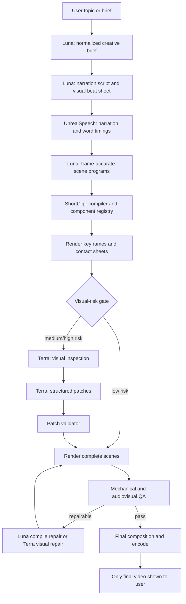

# ShortClipr Luna–Terra animation system

Routing revision: [Scene capability routing](SHORTCLIPR_SCENE_ROUTING.md) is authoritative for model assignment, eligibility, retries and capability claims. The earlier generic Luna-first diagrams below are conceptual background only; production must route before code generation and may assign Terra directly or reject unsupported work.

Status: authoritative AI-model and code-animation design  
Date: 3 November 2026  
Parent architecture: [`SHORTCLIPR_FINAL_OUTPUT_PIPELINE.md`](SHORTCLIPR_FINAL_OUTPUT_PIPELINE.md)

ShortClipr uses only two OpenAI models in the normal video-generation path:

- **GPT-6 Luna** creates the narrative script, visual script, scene contracts, timing plan, component selections, and first-pass animation program.
- **GPT-6.1 Terra** acts as visual director, generates or repairs visually demanding scoped animation code, inspects rendered frames, and returns precise visual corrections.

The models do not render video pixels. Versioned ShortClipr renderers compile their structured animation programs and produce frames deterministically. This separation is required for consistent output, reproducible repairs, predictable cost, and safe execution.

No intermediate creative output is exposed to the user. The user submits once and receives only the finished video.

---

## 1. Fixed decisions

1. `gpt-6-luna` is the default model for all text, planning, routing, scene-program, and routine animation-code work.
2. `gpt-6.1-terra` is used only where visual judgment or a scoped visual-code correction materially improves the result.
3. Sol and Astra are not part of the normal production path.
4. A scene that exceeds the supported Luna–Terra envelope is simplified into validated primitives rather than silently escalating to a more expensive model.
5. Models return strict structured outputs. Free-form code is allowed only inside narrowly scoped, validated component patches.
6. Existing animation primitives are preferred over generated code.
7. A generated component that passes review can enter the reusable registry only through a separate tested promotion process.
8. Every animation is evaluated by absolute frame, not wall-clock browser state.
9. Render only affected scenes after a repair.
10. The final encoded video is the first creative media visible to the user.

---

## 2. Why two small models can produce excellent video

Excellent output does not require inventing an animation engine for every video. It requires:

- Strong art direction.
- A rich library of tested primitives.
- Precise narration-to-frame timing.
- Deterministic composition.
- Visual inspection of actual renders.
- Targeted repair rather than full regeneration.

ShortClipr creates novelty through combinations, timing, staging, camera, palette, typography, data, and narrative structure. The models operate a controlled visual language; the runtime guarantees that language renders correctly.

The system therefore optimizes for **bounded creativity**:

```text
creative brief
    + validated style pack
    + reusable animation vocabulary
    + Luna scene intelligence
    + Terra visual judgment
    + deterministic renderer
    = varied but production-safe final videos
```

---

## 3. Responsibility split

### GPT-6 Luna

Luna owns:

- Brief normalization.
- Clip-type and style compatibility routing.
- Concept selection.
- Narration and dialogue writing.
- Hook, pacing, progression, and payoff.
- Visual script and beat sheet.
- Shot and scene decomposition.
- Narration-to-frame mapping.
- Component and asset selection.
- Scene-program generation.
- Routine SVG, Canvas, and Revideo code within a supplied scaffold.
- Compile-error and schema-error repair.
- Continuity and factual consistency checks.
- Selecting which frames Terra should inspect.

Use Luna effort deliberately:

| Task | Effort |
|---|---|
| Classification, validation, routing | `low` |
| Script and visual script | `medium` |
| Scene program using existing components | `medium` |
| Scoped SVG/Canvas/Revideo component | `high` |
| Difficult repair with clear failure evidence | `high` |

`xhigh` and `max` are disabled in the ordinary generation path until evaluations show that they beat a Terra review or a simpler scene at lower total cost.

### GPT-6.1 Terra

Terra owns:

- Visual-direction review.
- Composition and hierarchy review.
- Contrast, spacing, balance, density, and safe-area inspection.
- Cross-ratio layout correction.
- Continuity review using contact sheets.
- Detection of clipping, collision, weak focal points, tiny labels, awkward crops, and visually dead frames.
- Scoped corrections to SVG, CSS, Canvas, Revideo, and supported Three.js component parameters.
- Refining camera, lighting, depth, staging, and motion emphasis.
- Reviewing visually sensitive scenes such as maps, dense data, isometric layouts, layered environments, and limited 3D.

Use Terra effort deliberately:

| Task | Effort |
|---|---|
| Single-frame visual check | `low` |
| Contact-sheet review and defect list | `medium` |
| Scoped visual-code repair | `medium` or `high` |
| Multi-scene continuity repair | `high` |

Terra does not rewrite a whole project when one scene is defective.

### Deterministic runtime

The runtime owns:

- Schema validation.
- Type checking and linting.
- Component lookup.
- Frame calculation.
- Layout constraints.
- Seeded randomness.
- Asset loading.
- Rendering.
- Audio mixing.
- Encoding.
- Mechanical quality checks.
- Dependency hashing and caching.

---

## 4. End-to-end model flow



### Call sequence

1. **Luna brief pass** — one compact request produces normalized intent, clip type, tone, risks, research requirements, and target structure.
2. **Luna script pass** — one request produces the narration plus visual beats, not prose-only narration.
3. **UnrealSpeech pass** — narration is synthesized and actual word timings become authoritative.
4. **Luna scene pass** — scenes are generated against actual narration duration and a supplied component catalogue.
5. **Local validation** — reject invalid actions without spending another model call where possible.
6. **Local keyframe render** — render representative frames and a contact sheet.
7. **Terra risk-based review** — send only scenes that benefit from visual judgment.
8. **Local final render** — render all frames after approved patches.
9. **Targeted repair** — use error evidence and the smallest relevant source/context.

---

## 5. Animation vocabulary

Luna and Terra must compose from a versioned registry rather than inventing arbitrary APIs.

### Typography

- Word-by-word captions.
- Kinetic headlines.
- Character, word, or line reveals.
- Number counters.
- Text-on-path.
- Masked typography.
- Highlight sweeps.
- Emphasis pulses.
- Label and callout systems.

### Data and explanation

- Bar, line, area, donut, and radial charts.
- Comparisons and scoreboards.
- Timelines.
- Process flows.
- Cause-and-effect diagrams.
- Network graphs.
- Before/after transformations.
- Scale journeys.
- Map routes and geographic focus.

### 2D visual motion

- Shape morphs from compatible paths.
- Trim-path drawing.
- Masks and mattes.
- Parallax layers.
- Paper-cutout rigs.
- Comic panels.
- Isometric tiles.
- Particle fields.
- Trails, glows, shadows, blur, and depth haze.
- Camera pan, push, orbit simulation, rack-focus simulation, and shake accents.

### Characters

- Prebuilt body rigs.
- Pose changes.
- Eye, mouth, and expression states.
- Walk, point, react, speak, and gesture cycles.
- Prop attachment.
- Staged two-character dialogue.

The models may select and time these actions. They may not generate unconstrained skeletal systems per video.

### Limited 3D and 2.5D

- Layered depth planes.
- Extruded text and shapes.
- Prebuilt GLTF props and environments.
- Validated camera paths.
- Validated lighting presets.
- Object transforms and material parameters.
- Seeded particle and instancing presets.

Custom GLSL, arbitrary physics, new skeletal rigs, and unrestricted Blender scripting are outside the normal Luna–Terra generation envelope. Heavy-looking results should use prebuilt systems with model-generated direction and parameters.

---

## 6. Scene-program contract

Models return a scene program, not a complete application.

```json
{
  "schema_version": "1.0",
  "scene_id": "scene_04",
  "purpose": "Show the moon blocking sunlight from Earth",
  "frame_range": [246, 389],
  "style_pack": "technical_blueprint@3",
  "layout": {
    "preset": "focal_center_with_side_labels",
    "safe_area": "shorts_standard",
    "focal_element_id": "moon"
  },
  "camera": {
    "preset": "slow_push_in",
    "intensity": 0.28
  },
  "elements": [
    {
      "id": "sun",
      "component": "RadialStar",
      "region": "left_third",
      "props": {"color_token": "accent_warm"}
    },
    {
      "id": "moon",
      "component": "OrbitalBody",
      "region": "center",
      "props": {"radius": 132}
    },
    {
      "id": "earth",
      "component": "OrbitalBody",
      "region": "right_third",
      "props": {"radius": 176}
    }
  ],
  "actions": [
    {
      "component_id": "moon",
      "action": "translate_between_anchors",
      "start_frame": 266,
      "end_frame": 338,
      "easing": "smooth_in_out"
    },
    {
      "component_id": "earth",
      "action": "shadow_cone_reveal",
      "start_frame": 310,
      "end_frame": 360
    }
  ],
  "narration_words": [42, 58],
  "review_frames": [246, 300, 338, 389],
  "rejection_rules": [
    "orbital_bodies_overlap_labels",
    "focal_subject_outside_safe_area"
  ]
}
```

### Contract rules

- Every enum is sourced from the supplied registry revision.
- Coordinates use named regions or normalized values, never unexplained magic pixels.
- Timing is expressed in absolute frames.
- Colors, fonts, strokes, shadows, and spacing use style tokens.
- Every action declares start and end frames.
- Every scene declares representative review frames.
- Every scene declares machine-checkable rejection rules.
- No model-produced URL or package import is executed.

Use OpenAI Structured Outputs with `strict: true` for all planning and scene-program responses.

---

## 7. When generated code is allowed

Most videos should require no new source code. A model-produced code patch is allowed only when:

- The registry has no equivalent primitive.
- The requested effect can be expressed inside an existing scaffold.
- The patch touches one component or one scene adapter.
- Imports are selected from an allowlist.
- Network, filesystem, process, dynamic import, and runtime package installation are unavailable.
- The patch passes static analysis, type checking, unit tests, and render smoke tests.
- The patch has an explicit frame, memory, and execution budget.

### Code-generation order

1. The capability router assigns the cheapest qualified model before any attempt; Luna is used only within its measured envelope and Terra can be assigned directly.
2. Local tools compile and render representative frames.
3. Local fixes or a qualified repair model handle exact diagnostics; a capability mismatch immediately stops attempts with the failing model.
4. Terra reviews visual failures and returns a minimal visual patch.
5. If two repair cycles fail, replace the effect with the closest validated primitive.

This produces a finished video instead of an expensive infinite repair loop.

---

## 8. Terra visual-review packet

Do not send the full video to Terra. Build the smallest packet that preserves the visual problem:

- One contact sheet with 6–12 representative frames.
- Individual full-resolution frames only for detected problem areas.
- Scene purpose and narration excerpt.
- Aspect ratio and safe-area overlay.
- Style-pack tokens.
- Relevant scene program.
- Component metadata.
- Automated defect signals.

Terra returns strict JSON:

```json
{
  "scene_id": "scene_04",
  "verdict": "repair",
  "defects": [
    {
      "frame": 338,
      "severity": "critical",
      "category": "collision",
      "element_ids": ["moon", "caption_2"],
      "evidence": "The moon overlaps the second caption line.",
      "patch": {
        "operation": "set_layout_region",
        "element_id": "moon",
        "value": "center_upper"
      }
    }
  ]
}
```

Allowed patch operations are versioned and validated. Terra cannot inject arbitrary source through a layout patch.

---

## 9. Risk gate

Terra is not called for every scene. The local router assigns a visual-risk score.

### Send to Terra when any condition is true

- More than eight simultaneously visible elements.
- Dense text or data.
- A map or isometric layout.
- Multiple characters.
- Perspective or depth composition.
- Important subject near a safe-area boundary.
- Large difference between aspect-ratio layouts.
- Generated illustration or user asset with uncertain crop.
- Automated collision/readability check fails.
- A new or recently changed component is used.
- The capability registry or observed defects require review; model self-confidence cannot establish eligibility.

### Skip Terra when

- The scene uses a mature preset.
- All machine checks pass.
- Element count and text density are low.
- The same component/style/ratio combination has passed recent production renders.

This is the main Terra cost-control mechanism.

---

## 10. Quality and repair loop

### Before rendering

- JSON Schema validation.
- Component/action allowlist validation.
- Asset existence and license checks.
- Frame-range and narration-fit validation.
- Cross-scene entry/exit continuity validation.
- Ratio compatibility validation.

### Render smoke test

Render first, middle, last, action-boundary, and caption-boundary frames for each scene.

Check locally:

- Blank or transparent frame.
- Missing asset or font.
- Runtime exception.
- Element outside bounds.
- Bounding-box collision.
- Caption safe area.
- Minimum text size.
- Contrast threshold.
- Frozen motion where motion is required.
- Excessive per-frame render time.

### After full render

- Decode every frame.
- Validate duration, dimensions, frame rate, and codec.
- Validate narration and caption timing.
- Check scene boundaries and final-frame completeness.
- Compare selected frames against Terra-approved corrections.
- Re-render only invalidated scenes.

### Repair budget

- One Luna code/contract repair.
- One Terra visual repair.
- One final deterministic rerender.
- If still critical, simplify the scene to a validated fallback.
- Fail the generation only if the fallback cannot preserve the core meaning.

---

## 11. Rendering stack

### Primary: Revideo

Use Revideo for:

- TypeScript/TSX scene compositions.
- Typography.
- SVG and Canvas layers.
- Audio synchronization.
- Sequencing and transitions.
- Captions.
- Final scene composition.

All motion must be reproducible from the requested time/frame, inputs and seed using tested interpolation and spring utilities. Render stills or partial ranges for cheap internal QA before rendering the complete scene.

### Secondary: Canvas and Three.js

Use Canvas for dense particles, diagrams, maps, and simulations that would create excessive DOM nodes.

Use Three.js only through validated wrappers for:

- 2.5D depth.
- Camera movement.
- Prebuilt 3D assets.
- Lighting presets.
- Instancing and controlled particles.
- Limited object animation.

Three.js state must be derived from absolute frame or baked simulation data so renders remain deterministic.

### Final composition

Use Revideo `renderVideo()` for the default complete composition. The retained `shortclipr-ffmpeg-worker-*` service is the render worker and contains Revideo, Chromium and FFmpeg. Use FFmpeg directly for:

- Compatible scene stitching in the measured split-render path.
- Audio mix or muxing when it is not already completed in the Revideo render.
- Loudness normalization.
- Input normalization, probing and final decode validation.

Do not perform a second full encode when the Revideo output already satisfies the delivery contract.

---

## 12. Cost design

Current standard text-token rates used for planning are:

| Model | Input / 1M | Cached input / 1M | Output / 1M |
|---|---:|---:|---:|
| GPT-6 Luna | $0.10 | $0.01 | $0.50 |
| GPT-6.1 Terra | $1.00 | $0.05 | $5.00 |

These rates are not a guaranteed per-video price. Image inputs, reasoning, retries, processing mode, and future pricing affect actual cost.

### Engineering budget target per finished minute

| Work | Target |
|---|---:|
| Luna planning, script, visual script, scene programs | $0.005–$0.020 |
| Terra selective visual review and patches | $0.015–$0.100 |
| Total OpenAI model target | **$0.02–$0.12** |

Complex or repair-heavy minutes may exceed the target. Measure actual API usage; do not bill from estimates.

### Cost controls

- Put stable system instructions, schemas, component catalogue, and examples first for prompt caching.
- Send only catalogue entries relevant to the selected style and scene type.
- Use strict structured outputs to remove format-retry calls.
- Keep code patches scoped to one component.
- Use contact sheets instead of many separate image requests.
- Use Luna to select the minimum frames Terra needs.
- Cache Luna outputs by normalized request and version hashes where product semantics allow it.
- Cache final scene renders by full dependency hash.
- Use Flex for eligible asynchronous Luna/Terra calls with safe retry to Standard when capacity is unavailable.
- Consider Batch for offline evaluations and bulk benchmark suites, not latency-sensitive single-user stages unless its completion behavior meets product expectations.
- Track cached, uncached, reasoning, image-equivalent, and output tokens separately.

---

## 13. Model configuration

Reuse the retained `OPENAI_API_KEY` secret. Do not create separate API keys for Luna and Terra.

Model IDs are versioned application configuration, not casual environment overrides:

```yaml
ai_pipeline_revision: luna-terra-v1
planner_model: gpt-6-luna
visual_model: gpt-6.1-terra
luna_default_effort: medium
terra_default_effort: medium
max_luna_repair_calls: 1
max_terra_review_calls: 1
allow_unvalidated_model_fallback: false
```

Changing a model or effort level requires:

- Golden-set evaluation.
- Cost comparison.
- Render-quality comparison.
- Prompt/schema revision pinning.
- Admin-controlled rollout.
- Rollback support.

Use the Responses API for tools, image inputs, and strict structured workflows.

---

## 14. Backend jobs

```text
brief.normalize.luna
script.visualize.luna
voice.generate.unrealspeech
scenes.program.luna
scenes.validate.local
scenes.smoke_render.local
scenes.risk_score.local
scenes.visual_review.terra
scenes.patch.local
scenes.render.local
project.qa.local
project.repair.luna_or_terra
project.encode.local
project.deliver
```

Each job stores:

- Model and effort.
- Prompt revision.
- Schema revision.
- Component-catalogue revision.
- Input and output hashes.
- Token usage and cached-token usage.
- Latency and processing mode.
- Repair reason.
- Render artifacts affected.

---

## 15. Evaluation programme

Do not decide that Luna or Terra is “good enough” from a few attractive examples.

Build a golden set covering:

- All 16 approved clip types.
- Four durations.
- Three aspect ratios.
- Every production style pack.
- Sparse and detailed briefs.
- All supported narration languages.
- Text-heavy, character-heavy, data-heavy, and motion-heavy scenes.

Measure:

- Schema pass rate.
- First compile pass rate.
- First render pass rate.
- Critical visual-defect rate.
- Terra invocation rate.
- Repair success rate.
- Fallback/simplification rate.
- Human visual-quality score.
- Narration synchronization error.
- Cost per finished minute.
- End-to-end generation time.

### Initial release gates

- At least 99% schema-valid outputs after API-level structured enforcement.
- At least 95% scene compile success without manual intervention.
- No critical caption safe-area failures in the golden set.
- No delivery when automated codec/audio/frame checks fail.
- Median OpenAI model cost within the declared budget for the tested mix.
- Every supported style/ratio combination passes a human art-direction review before becoming available.

Tune thresholds using real measurements before public launch.

---

## 16. Supported complexity envelope

### Strong default capability

- Kinetic typography.
- Captions and word emphasis.
- Charts, timelines, comparisons, maps, and diagrams.
- Quizzes and visual puzzles.
- Paper-cutout and comic-panel stories.
- Parallax and layered 2.5D scenes.
- Character dialogue using existing rigs.
- Isometric environments using existing tiles.
- Product and object animation using supplied assets.
- Controlled particles, trails, glows, masks, and reveals.
- Prebuilt 3D scenes with model-directed staging and camera.

### Supported through decomposition

- Space journeys built from scale, camera, depth, and particle primitives.
- Architecture transformations built from modular room components.
- Simulations calculated deterministically and visualized through known components.
- Stylized anime-like edits using panels, speed lines, impact frames, and controlled camera effects.

### Not generated freely per request

- New animation engines.
- Arbitrary shader systems.
- Unbounded physical simulation.
- New production character rigs.
- Long unconstrained Blender scripts.
- Complex inverse kinematics.
- Arbitrary third-party packages.

These may become available later as tested registry capabilities. The product should expand by adding reliable primitives, not by increasing unbounded model freedom.

---

## 17. Definition of done

The Luna–Terra system is implemented only when:

- Luna returns strict brief, script, visual-script, and scene-program contracts.
- Narration timing is authoritative before final scene timing.
- The component registry is versioned and allowlisted.
- Code generation is sandboxed and scoped.
- Keyframe and partial-frame rendering works.
- Terra receives minimal visual-review packets and returns validated patches.
- Risk routing prevents unnecessary Terra calls.
- Repairs invalidate only affected artifacts.
- Model, prompt, schema, catalogue, token, and cost data are recorded.
- Golden-set gates pass.
- No intermediate media is exposed publicly.
- The finished encoded video remains the first user-visible creative result.

The operating principle is:

> **Luna decides and programs; Terra sees and perfects; deterministic renderers produce the final video.**

---

## 18. Official implementation references

- [GPT-6 Luna model capabilities and pricing](https://developers.openai.com/api/docs/models/gpt-6-luna)
- [GPT-6.1 Terra model capabilities and pricing](https://developers.openai.com/api/docs/models/gpt-6.1-terra)
- [OpenAI model-selection guidance](https://developers.openai.com/api/docs/guides/model-selection)
- [OpenAI Structured Outputs](https://developers.openai.com/api/docs/guides/structured-outputs)
- [OpenAI prompt caching](https://developers.openai.com/api/docs/guides/prompt-caching)
- [OpenAI cost optimization](https://developers.openai.com/api/docs/guides/cost-optimization)
- [OpenAI API pricing](https://developers.openai.com/api/docs/pricing)
- [Revideo repository and capabilities](https://github.com/midrender/revideo)
- [Revideo MIT license](https://github.com/midrender/revideo/blob/main/LICENSE)
- [Revideo rendering guide](https://midrender.com/revideo/docs/guide/rendering-videos)
- [Three.js animation mixer](https://threejs.org/docs/pages/AnimationMixer)

