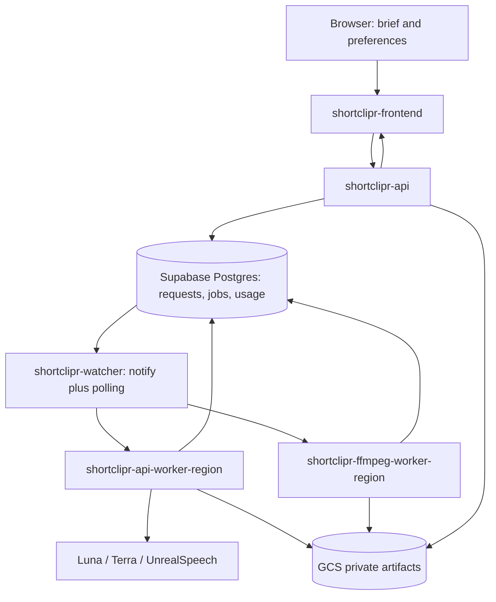

# ShortClipr implementation blueprint

3 November 2026. Design specification; runtime, infrastructure changes and benchmarks have not been implemented by this document.

## Authority and evidence

This is the overall architecture entry point. PLATFORM_HANDOFF.md controls retained infrastructure and environment names; SHORTCLIPR_PRODUCT_SCOPE.md controls the 19 included categories; SHORTCLIPR_SCENE_ROUTING.md controls model eligibility. This document supersedes older dispatch, render and orchestration proposals where they conflict. Archived platform-reference files remain unchanged historical evidence.

Deployment mapping below was inspected in the saved Cloud Build files, not verified against a live GCP account. Runtime regions, secret versions, trigger configuration, bucket ACLs and quotas require a read-only deployment inventory before rollout. A push works only after restored build paths and existing triggers agree.

## Product and creative system

Create form: topic or brief, supported UnrealSpeech language/voice, visual style or AI Auto, duration up to 60 seconds, aspect ratio 9:16/16:9/1:1, optional captions and assets. Dashboard -> Create -> generation status -> final player/download. Intermediate scripts, imagery and audio stay private. Existing name and public logo assets remain.

Separate four decisions: clip type (what story), visual style (how it looks), scene grammar (how information unfolds), and rendering method (how pixels are calculated). No clip category owns its own backend service.

Luna drafts the story with hook, progression and payoff plus a visual explanation for each beat. Source-dependent factual claims require retrieved evidence; a model verdict alone is not verification. A capability pass checks the proposed shots before provider spending. Style selection is restricted to tested combinations of style, renderer, ratio and language/font support.

Every style pack defines palette, fonts/fallbacks, shape language, spacing, motion/easing, camera limits, lighting, textures, transitions, caption rules and sound character. Every scene defines purpose, focal action, entry/exit state, narration word references, layout constraints, asset revisions and rejection conditions. Compose variation through staging and narrative meaning, not random decoration. Preserve one coherent visual language across the film.

The scene router considers novelty, coupling, geometry, motion, visual reasoning and timing separately. Local runtime handles existing programs. Luna receives qualified parameter/composition tasks; Terra receives qualified visual/coding tasks directly when Luna is ineligible. Neither gets unsupported work by default. No obligatory Luna attempt, model ping-pong or fixed percentage of Luna calls.

## Exact service map

| Retained service | New responsibility | Preserved interface/baseline |
|---|---|---|
| shortclipr-frontend | Vite/React, Nginx, creation/status/final output, /admin UI | Port 8080; image shortclipr-frontend |
| shortclipr-api | Python API, Google OAuth/JWT, submission, entitlement, final signing, Dodo, admin | Port 8080; backend image shortclipr-worker |
| shortclipr-api-worker-{region} | Luna/Terra calls, research, voice, asset planning, qualification routing | POST /internal/api-stage/run; saved build: 4 CPU, 2Gi, concurrency 12, min 0/max 5, timeout 300s |
| shortclipr-ffmpeg-worker-{region} | Compile, internal frames, scene chunks, composition, audio, encoding and QC | POST /internal/ffmpeg-stage/run; saved build: 4 CPU, 8Gi, concurrency 1, min 0/max 5, timeout 1500s |
| shortclipr-watcher | Durable ready-job dispatch, region selection, leases, recovery | Separate shortclipr-watcher image; saved build: europe-west1, 1 CPU/512Mi, min/max 1, CPU always allocated |

Worker build default is us-central1 with _REGION substitution; actual deployed worker URLs come from retained URL lists. Keep watcher singleton but use database claims because deploy revisions can overlap. Preserve the Artifact Registry path us-central1-docker.pkg.dev/$PROJECT_ID/cloud-run-source-deploy. Do not restore the retired factloop worker or its queue.

## Physical data flow

Large assets and code artifacts travel through GCS; jobs carry references and hashes. Browser calls only the public API and scoped upload/download URLs. Worker model calls never run in browser or public API request handlers.

## Stage graph and durable boundaries

| Stage | Owner | Required output |
|---|---|---|
| submit | API | Atomic request, credit reservation, initial job |
| normalize/research | API worker | Brief contract, claims/evidence |
| script/direction | API worker, Luna | Narrative, visual beats, style revision |
| capability plan | API worker local router | Qualified scene operations or terminal unsupported result |
| voice and assets | API worker, independent jobs | Audio/timestamps; asset manifest |
| timing/layout | API worker | Integer-frame timeline, ratio layout |
| program each scene | API worker, selected model or local compiler | Versioned scene program |
| compile/smoke frames | Render worker (`shortclipr-ffmpeg-worker-*`) | Diagnostics and internal evidence |
| visual/motion review | Local checks plus API worker if model needed | Timestamped defects/acceptance |
| render scene or chunk | Render worker (`shortclipr-ffmpeg-worker-*`) | Revideo artifacts and manifest |
| compose/audio/encode | Render worker (`shortclipr-ffmpeg-worker-*`) | Revideo final or split-path FFmpeg candidate |
| final validation | Render worker (`shortclipr-ffmpeg-worker-*`) | ffprobe/decode QC report, checksum |
| publish | API worker transaction | Final pointer, completed state, settled usage |

Group inexpensive planning steps into bounded calls when appropriate; durable boundaries are not automatically one model call each. Voice and independent asset retrieval run concurrently after script/direction freeze. Scene jobs become ready only after required assets and timing exist. Composition waits on all scene dependencies. Any changed narration invalidates timing-dependent programs, captions and renders.

## Queue correctness and execution

Postgres is the durable queue; NOTIFY carries a job ID only and acts as a wake-up hint. Watcher also polls due rows and reconciles expired leases so disconnects cannot lose jobs. LISTEN uses a dedicated session connection, never a transaction-pool connection; if the retained DB URL is pooled, add a separate proposed SUPABASE_LISTEN_DB_URL and retain SUPABASE_DB_URL for ordinary queries.

Claim ready jobs with a short transaction and FOR UPDATE SKIP LOCKED. Assign attempt number, random lease token, expiry, chosen region and revision. Commit before making HTTP calls. Never hold database locks while waiting on model or render work.

Watcher sends job ID, attempt, lease token and input revision to the retained internal endpoint. Worker verifies ownership, atomically starts the attempt, renews lease and holds the HTTP request open while that bounded stage executes. Request timeout is a ceiling, not job cancellation. Application stage deadlines must be shorter than it; split long work into checkpointed jobs.

Completion is a compare-and-set on job ID plus lease token and revision. A stale worker may leave an orphan object but cannot publish or debit again. HTTP loss does not imply provider failure: inspect persisted attempt/provider references before retrying. External APIs may still incur duplicate charges after an ambiguous timeout; record and budget that uncertainty instead of promising exactly-once calls.

Job states: pending, ready, leased, running, retry_wait, succeeded, failed, cancelled. Project states: queued, generating, checking, complete, failed, cancelled. Progress uses weighted completed work, not fabricated time estimates. Client reconnect reads durable state.

Cancellation blocks new claims, cancels active processes where possible, fences later completion and settles unused reservation. A late successful attempt cannot resurrect a cancelled project. Shutdown stops new work and records checkpoints; lease expiry enables recovery.

## Data model and transactions

Preserve users UUIDs and OAuth identity fields; retain webhook/event tables from the handoff. The new DB receives old users only, not retired jobs or quota records. Keep the old DB intact; migration needs counts, uniqueness checks and sign-in validation.

New tables:
- projects: owner, status, active version, final artifact, deletion state.
- generation_requests: immutable settings and unique (owner, idempotency_key).
- project_versions: parent, script/style/timeline revisions, manifest hash.
- scenes: version, scene ID, dependencies, program and route evidence.
- jobs and job_dependencies: operation, input hash, due time, attempt, lease, result/error.
- job_attempts/model_calls: provider request ID, model/effort/prompt revision, token usage, latency and cost.
- assets/artifacts: owner scope, immutable object generation, hash, type, retention and dependencies.
- capability_registry/style_packs/component_registry: immutable revisions and qualified envelopes.
- quality_reports: artifact revision, frame/time, defect class, evidence, verdict.
- usage_ledger: reservation, settlement, release; unique operation key.
- outbox_events: durable completion, tracking and notification work.
- admin_audit: actor, action, target, reason and revision.

Index ready jobs by status/due time and job class; index leases by expiry; index projects by owner/created time. Enforce owner checks at every API boundary. Database role privileges restrict worker operations. Use bounded pools per instance and budget aggregate connections across all regions/max instances.

Submission locks the entitlement/balance row, validates available allowance and atomically reserves usage plus inserts request/jobs. Repeated submission returns the same request. Completion verifies final QC and artifact identity, publishes the final pointer and settles reservation once in one transaction. Tracking/outbound email is delivered through the outbox independently.

## Fast rendering design

### Renderer decision

Use **Revideo as the primary animation and composition engine**. Use **FFmpeg/ffprobe as its encoding and media-finishing layer**. Both are available without a per-render software charge: Revideo is MIT licensed, while FFmpeg is LGPL or GPL depending on the selected build and optional components. Maintain their notices and a software bill of materials.

- Revideo owns TypeScript/TSX scene components, Canvas/SVG/Rive/Three.js integration, deterministic animation flow, scene sequencing, captions, camera/layout composition and synchronized media.
- FFmpeg owns probing, input normalization, codec/container operations, loudness work, compatible segment concatenation, final muxing when renders are split, and output validation.
- Do not generate complex visual scenes as large FFmpeg filter graphs. They are harder to author, inspect and repair than scene components.
- Do not run an automatic second full FFmpeg encode after a successful Revideo final render. Validate it with ffprobe and decoding. Re-encode only when a required finishing operation cannot be completed in the first render.

The retained Cloud Run name `shortclipr-ffmpeg-worker-{region}` does not choose the implementation. Its new container is the **render worker** and includes pinned Node, Chromium, Revideo and FFmpeg. Renaming the deployed service would create deployment work without improving the renderer.

Default path: Revideo `renderVideo()` produces the completed delivery file and ffprobe plus a decode pass validate it. Split path: `renderPartialVideo()` produces compatible scene/chunk intermediates, then FFmpeg concatenates them and performs one audio/final encoding operation. Select the split path only when measured parallelism or targeted repair beats the default path.

Revideo's repository and license declare MIT terms, including commercial use without a renderer subscription. Pin a reviewed commit/package version and vendor-critical adapters so an upstream change cannot silently alter production renders. Set `DISABLE_TELEMETRY=true` in the render worker because ShortClipr already has its own observability. Free software does not remove Cloud Run, storage, model, voice or bandwidth costs.

Baseline: 1080 output, 30 fps, integer-frame timeline; 60 seconds means 1800 frames. Alternative frame rates become separate tested profiles. Support all three ratios through layout rules, not stretching or indiscriminate center crops.

Use prebundled Revideo with Canvas/SVG as the default. Avoid per-video package installs or full app bundling. Bundle trusted components during the image build. Render programs are data, so most scenes reuse the same bundle. Custom code stays experimental until isolation and qualification are proven.

Reuse a browser process within a worker with fresh scene/page contexts and bounded cache lifetime. Warm fonts/assets once per job; cache immutable public component assets across jobs with memory limits. Rasterize complex static layers once, render moving overlays only where beneficial, and select Canvas for dense geometry. Three.js is restricted to profiled presets; WebGL software rendering on CPU can be slow, so do not presume GPU acceleration on existing services.

Use internal small stills for initial layout checks, followed by full-resolution crops and temporal samples where needed. These are never user previews. Final-resolution checks remain mandatory because low-resolution renders can conceal text and edge defects.

Render scenes independently when boundaries permit. For a long expensive scene, split frame intervals with explicit exclusive/inclusive boundaries, deterministic state and transition handles. Bake simulations before parallel rendering. Do not split stateful animation without reproducible seeking.

Start with one active render job per 4 CPU/8Gi instance. Benchmark browser frame concurrency 1/2/4 instead of assuming more tabs are faster. Reserve CPU for encoding; avoid running several encoders and browser renders simultaneously. Temporary files and frame buffers consume memory; budget them, stream where possible, clean between jobs and terminate runaway children.

Choose chunk size from measured render seconds/frame and dispatch/upload overhead. Start experiments with whole short scenes versus 5–10 second chunks; keep whole-scene rendering when splitting adds overhead. Global scheduler limits simultaneous chunks per project so one video cannot starve others.

Store silent scene intermediates with common dimensions, fps, pixel format, codec settings and closed boundaries. Use FFmpeg stream concatenation only after compatibility checks. Transitions spanning scenes require overlap handles and composition work. Mix narration/music/effects once; avoid independent audio encodes per chunk and resulting drift. Encode final audio once and validate duration/end frame. Do not promise zero recompression when filters/transitions require it.

Cache key includes normalized scene program, asset hashes, style/component revisions, renderer image digest, fonts, seed, dimensions, fps and output settings. Cache lookup requires owner/public-asset authorization. Regenerate only dependency-affected artifacts; global grading/caption changes may invalidate composition even when scene images remain reusable.

## Regional scheduling and capacity

Prefer a region near the asset bucket and DB unless measured queue delay justifies overflow. Existing API_WORKER_URLS/API_WORKER_REGIONS and FFMPEG_WORKER_URLS/FFMPEG_WORKER_REGIONS define allowed destinations. Validate list lengths and URL/region mapping at startup.

Cloud Run concurrency is per instance, not total regional capacity. Saved comments conflate this with soft caps: document soft-cap semantics during implementation, and calculate an explicit regional slot budget from verified max instances, concurrency, shared CPU quotas and safety headroom. API and render workers compete for regional quota. Do not assume five instances of each can coexist under an example 20-vCPU quota.

Use global provider token/request semaphores plus regional compute limits. Weighted fair scheduling bounds per-user jobs and per-project render fanout. Admission estimates reserve model and compute budgets before fanout. Retry 429/unavailability with jitter and provider retry hints; no repeated cross-region retries for a global provider limit.

Keep min render instances at zero initially; test one warm instance in the busiest region only if cold-start latency justifies idle cost. Keep watcher min 1 with CPU available outside requests. Deployment settings are proposals until verified against actual quota and workload measurements.

## Storage and access

GCS layout: users/{owner}/projects/{project}/versions/{version}/{internal|final}/... with attempt-specific temporary prefixes. Database final pointer is the publication boundary; GCS has no assumed atomic directory rename. Upload immutable objects, verify metadata/hash, then publish transactionally.

Retain GCS_BUCKET_NAME and GCS_PUBLIC_BASE_URL names. The archived guide suggests a public bucket: verify actual IAM before placing internal assets there. A prefix is not an access boundary under bucket-wide public access. Use a private bucket configuration or a separate private bucket if existing public obligations prevent changing it. Final access is owner-authorized short-lived signed URLs; browser never receives worker credentials or internal URLs.

Stage user uploads through MIME/size/decode validation and normalized asset storage. Signed upload grants bind to owner/object/limits. Delete projects through tombstones, cancellation and asynchronous cleanup; retention must not delete active or referenced assets. Store provider audio under controlled GCS paths before provider URLs expire.

## API and authentication

Public proposed routes: POST /auth/google, GET /me, GET /voices, GET /styles, POST /projects, POST /projects/{id}/generations, GET /generations/{id}, POST /generations/{id}/cancel, GET /projects/{id}/download, DELETE /projects/{id}, POST /billing/checkout and the restored verified Dodo webhook route. Confirm exact auth/billing route compatibility during restoration. Internal stage routes above remain fixed.

Retain custom Google OAuth verification and application JWT; this is not a Supabase Auth migration. Browser VITE_GOOGLE_CLIENT_ID matches backend GOOGLE_CLIENT_ID. Validate audience/issuer/expiry and bind account identity by google_sub. JWT uses retained secret/expiry configuration; admin authorization is server-side and logged.

Use polling with backoff/ETag for status initially; SSE is optional and must reconnect from durable state. /admin exposes queue/attempts, spend, capability quarantine, style availability, failed artifacts and audited retry/cancel controls. Admin retry creates a fresh fenced attempt and cannot duplicate billing settlement.

## Environment and integrations

Use PLATFORM_HANDOFF.md for exact retained names. Frontend VITE_* values are build arguments. Keep secrets server-side in Secret Manager. API uses DB, JWT/Google, Dodo, storage, tracker and email configuration. API worker uses DB/storage, OPENAI_API_KEY, UnrealSpeech and internal auth. Render worker needs only DB/storage/internal auth, with no model/payment keys. Watcher needs DB, worker URL/region lists and internal credentials.

Proposed new UnrealSpeech variables remain UNREALSPEECH_API_KEY, UNREALSPEECH_API_BASE, UNREALSPEECH_MODEL, UNREALSPEECH_DEFAULT_BITRATE and UNREALSPEECH_CATALOG_TTL_SECONDS. Model IDs/efforts, repair budgets and qualified routes live in versioned application configuration, not unreviewed environment changes.

Preserve INTERNAL_TASK_SECRET support and constant-time validation. Prefer IAM-authenticated worker invocation with watcher service identity; changing IAM requires deployment configuration, not merely code. Do not leave a worker publicly callable without effective authentication. Never execute generated code in a credential-bearing process: start with declarative programs only; custom code needs a tested isolated runner without network/secrets and with resource limits before enablement.

Dodo webhook processing verifies signatures, deduplicates event IDs and handles order using retained event timestamps. Plan mappings and new quotas remain configurable; do not inherit retired limits. Refund/credit policy for failed generation is separate from provider charges already incurred.

TikTok, Meta, Google and Reddit tracking retain their identifiers and event contracts. Use stable event IDs for browser/server deduplication where supported. Outbox retries do not block video delivery. No private prompt/script content goes into analytics payloads.

## Build, deployment and repository plan

Restore root Dockerfile and cloudbuild-frontend.yaml for the Vite/Nginx app. Restore backend/Dockerfile and backend/cloudbuild-api.yaml, cloudbuild-api-worker.yaml, cloudbuild-ffmpeg-worker.yaml, cloudbuild-watcher.yaml at the paths expected by triggers. Watcher build references backend/watcher/Dockerfile; the archived copy lives under platform-reference/watcher and must be restored to the expected path, not blindly copied in place.

Proposed layout: frontend/src/{create,status,library,admin}; backend/app/{api,auth,billing,tracking,domain,jobs,providers,routing,storage}; backend/renderer/{compiler,components,styles,render,qa}; backend/watcher; backend/migrations; tests/{routing,jobs,render,e2e}; benchmarks. Python owns API/orchestration; a pinned Node/Revideo renderer runs as a supervised subprocess in the render-worker container with pinned Chromium and FFmpeg.

Keep shortclipr-worker image naming for API/worker services and shortclipr-watcher for dispatcher. Build once and promote the same immutable digest across API/worker roles where compatible; use role entrypoints so API never launches renderer processes. Pin browser, fonts, Node, FFmpeg and component dependencies. Preserve archived deployment copies unchanged.

Rollout: backward-compatible schema migration -> immutable images -> worker revision smoke tests -> API/watcher compatible revision -> small traffic/canary workload -> wider rollout. Jobs pin pipeline revision and route only to compatible workers. Drain old attempts before removing their runtime. Rollback must preserve artifact and schema compatibility. No destructive users migration or production deploy is implicit in this design.

## Quality, cost and observability

Critical gates: valid scene schema, source/evidence checks where applicable, narration language/voice, frame bounds, temporal continuity, caption legibility, audio integrity, codec/duration, complete ending. Model reviewers provide evidence, not factual certainty. All final renders decode before completion.

Trace request -> project version -> scene -> job attempt -> model call -> artifact. Measure queue delay, cold starts, stage latency, render frames/sec, memory peak, cache hit/miss, model eligibility decisions, first-pass acceptance, retries, provider cost and total cost per accepted video minute. Keep prompts out of ordinary logs; restrict diagnostic artifacts to owner/admin permissions.

End-to-end latency equals planning + max(voice, independent assets) + critical path of scene generation/review/render + composition/QC + queue delays. There is no measured speed guarantee yet. Benchmark representative 15/30/60-second videos across ratios, styles and languages, with cold and warm runs and realistic concurrent traffic. Compare whole-scene and chunked rendering, browser concurrency, encoding profiles and cache reuse. Count failed attempts and cloud/voice/storage/license costs, not just token costs.

Release in slices: (1) foundation and durable jobs, (2) deterministic renderer and fixed test films, (3) capability benchmarks and Luna planning, (4) direct qualified Terra routes and repairs, (5) complete final-only flow with billing/tracking, (6) expanded scene families and production load tuning. The 19 categories remain intended scope; only qualified combinations become selectable.

Definition of done: one submission survives worker interruption, produces a validated final video with correct voice/style/ratio, bills once, can be cancelled safely, preserves users/services/integrations, logs actual costs and has measured rendering/quality performance. Test lease races, duplicate webhooks, lost notifications, ambiguous provider timeouts, failed uploads, interrupted encoding and cancellation during publication before release.

## Technical references

- https://docs.cloud.google.com/run/docs/configuring/request-timeout
- https://docs.cloud.google.com/run/docs/about-concurrency
- https://docs.cloud.google.com/run/docs/configuring/billing-settings
- https://www.postgresql.org/docs/current/sql-notify.html
- https://github.com/midrender/revideo
- https://github.com/midrender/revideo/blob/main/LICENSE
- https://midrender.com/revideo/docs/guide/rendering-videos
- https://midrender.com/revideo/docs/guide/building-webapps/deploy-rendering-service
- https://midrender.com/revideo/docs/api-reference/renderer/renderVideo
- https://motion-canvas.io/docs/rendering/
- https://ffmpeg.org/faq.html
- https://ffmpeg.org/legal.html

